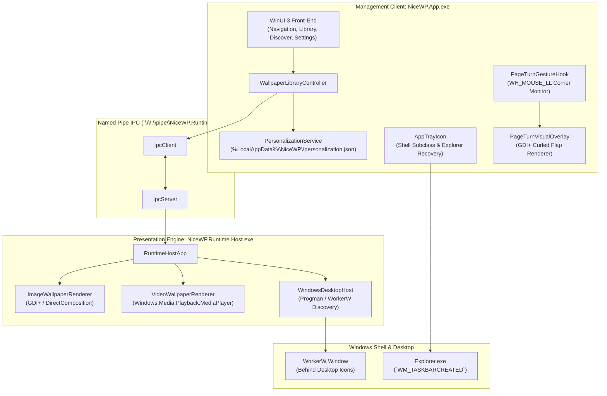

# NiceWP — Architecture Specification (0.0.23)

This document specifies the technical architecture, component separation, and runtime boundaries of NiceWP as finalized for Milestone 0.0.23.

---

## 1. System Topology & Dual-Process Model

NiceWP implements an isolated dual-process architecture communicating via Windows Named Pipes:

---

## 2. Solution Structure & Project Responsibilities

| Project | Target Framework | Responsibility |
| :--- | :--- | :--- |
| **`NiceWP.Core`** | `net10.0` | Zero-dependency contracts, data models (`WallpaperOrigin`, `SmartSceneContext`, `PersonalizationProfile`), enums, and mathematical algorithms. |
| **`NiceWP.Platform.Windows`** | `net10.0-windows10.0.19041.0` | Native Win32 interop, `WorkerW` discovery, display topology monitoring, and power status APIs. |
| **`NiceWP.Rendering`** | `net10.0-windows10.0.19041.0` | Surface renderers (`ImageWallpaperRenderer`, `VideoWallpaperRenderer`, DirectComposition integration). |
| **`NiceWP.Infrastructure`** | `net10.0-windows10.0.19041.0` | Persistent stores (Settings, Library, Analysis, Discover Cache, Personalization), IPC client/server, and localization. |
| **`NiceWP.Runtime`** | `net10.0-windows10.0.19041.0` | Wallpaper lifecycle coordinator, auto-pause policies, and environmental profiles. |
| **`NiceWP.Runtime.Host`** | `net10.0-windows10.0.19041.0` | Headless host application that attaches directly to WorkerW. Runs independently of UI lifecycle. |
| **`NiceWP.App`** | `net10.0-windows10.0.19041.0` | WinUI 3 desktop client, XAML views, system tray subclass, and Interactive Page Turn gesture hook. |

---

## 3. Subsystem Architecture

### 3.1 IPC Layer
- **Transport**: Duplex Named Pipes with length-prefixed JSON payloads.
- **Resilience**: Client verifies connectivity on startup and re-launches the host process automatically if terminated.

### 3.2 Smart Scenes
- **Analysis**: ITU-R BT.709 perceived luminance calculation and color temperature detection cached in `%LocalAppData%\NiceWP\wallpaper-analysis.json`.
- **Scoring**: Evaluates contextual constraints (Focus, Gaming, Relax, Night, Battery Saver) with recent repetition penalties.

### 3.3 Discover / Online Library
- **Governance**: Only permissive open-license repositories (Openverse, Wikimedia Commons, NASA) are queried.
- **Security**: Strict HTTPS enforcement, loopback/private IP blocking (SSRF prevention), size bounds, and magic byte validation.

### 3.4 Personalization Engine
- **Storage**: 100% local persistence in `%LocalAppData%\NiceWP\personalization.json`. Zero telemetry, zero cloud modeling.
- **Signals**: Explicit ("More Like This", "Less Like This", "Never Show Again") and implicit (favorites, manual apply).
- **Decay**: Lazy timestamp decay curves gently relaxing stale signals over months toward an asymptotic 0.20 floor.
- **Safety**: Scene hard constraints strictly override user preference.

---

## 4. Resilience & Error Handling

- **Atomic File Writing**: All persistence uses temporary staging files with atomic replacement.
- **Corruption Quarantine**: Malformed JSON files are backed up to `.bak` files rather than silently destroyed.
- **Shell Recovery**: On Explorer crash or restart (`WM_TASKBARCREATED`), tray icons and desktop attachments automatically restore.
