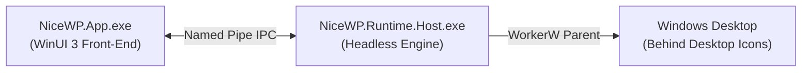

# NiceWallpaper (NiceWP)

> **Modern, Resource-Conscious Dynamic Wallpaper Engine for Windows 10 & 11**

[-blue.svg)](#supported-windows-versions)
[](https://dotnet.microsoft.com/)
[](https://github.com/microsoft/WindowsAppSDK)
[](#license)

NiceWallpaper (NiceWP) is a desktop wallpaper manager engineered specifically for Windows. It provides smooth static image and hardware-accelerated video wallpapers directly beneath desktop icons, pairing an **Interactive Page Turn** gesture with an **Adaptive Desktop Intelligence** runtime, **Smart Scenes**, **Discover / Online Library**, and a **100% Local Personalization Engine**.

---

## Overview

Unlike traditional wallpaper utilities that incur heavy continuous background CPU/GPU usage, NiceWP utilizes an isolated two-process architecture (`NiceWP.App` for UI, `NiceWP.Runtime.Host` for desktop rendering) with event-driven power policies. When games, fullscreen movies, or battery saver modes are active, wallpapers automatically pause or enter deep freeze, returning zero rendering load to your system.

---

## Features

- **Static & Video Wallpapers**: High-resolution image (JPG, PNG, WEBP, BMP) and hardware-decoded video (MP4, WEBM) desktop integration.
- **WorkerW Desktop Host**: Renders behind Windows desktop icons using native Win32 message hooks without overlay artifacts or taskbar interference.
- **Interactive Page Turn**: Global corner drag gesture featuring a 60 FPS real-time page curl visual overlay to preview and switch wallpapers fluidly.
- **Adaptive Desktop Intelligence**: Real-time environmental profiling, battery saver guardrails, and automated pause policies during fullscreen gaming or presentation.
- **Smart Scenes**: ITU-R BT.709 perceived luminance analysis, color temperature detection, and context-aware selection (Focus, Gaming, Relax, Night, Battery Saver).
- **Discover / Online Library**: Search and download high-quality, open-license wallpapers from Openverse, Wikimedia Commons, and NASA Image Library with complete provenance retention.
- **Local Personalization Engine**: Deterministic taste learning ("More Like This", "Less Like This", "Never Show Again", favorites scoring) with lazy timestamp decay and zero telemetry.
- **Bilingual Interface**: Native support for English and Turkish with instant language switching.
- **System Tray & Single Instance**: Lightweight system tray companion with quiet background startup.

---

## Screenshots

> See [`docs/release-screenshot-plan.md`](docs/release-screenshot-plan.md) for clean captures of the primary views.

| Library View | Active Wallpaper & Personalization |
| :---: | :---: |
| `docs/images/01_library_view.png` | `docs/images/02_active_wallpaper.png` |

| Discover Online Library | Smart Scenes & Settings |
| :---: | :---: |
| `docs/images/03_discover_view.png` | `docs/images/04_settings_view.png` |

---

## Installation

### Installer (Recommended)
Download the latest `NiceWP-0.0.23-win-x64-Setup.exe` from the [Releases](https://github.com/Cihanak1/NiceWP/releases) page and run the setup wizard.
- Installs to `%LocalAppData%\Programs\NiceWP` (requires no administrator privileges).
- Automatically configures desktop and start menu shortcuts.

### Portable ZIP
Download `NiceWP-0.0.23-win-x64.zip`, extract to any directory, and run `NiceWP.App.exe`.

---

## Supported Windows Versions

- **Windows 11**: All editions (x64)
- **Windows 10**: Version 1809 (Build 17763) or higher (x64)
- **Architecture**: x64 (ARM64 emulation supported via Windows 11 compatibility)

---

## How It Works

NiceWP separates management from presentation across two isolated processes:



1. **`NiceWP.App.exe`**: WinUI 3 management client. Provides the user interface, library browsing, discover queries, settings, and tray integration.
2. **`NiceWP.Runtime.Host.exe`**: Headless engine. Connects to Explorer's `WorkerW` window handle, managing DirectComposition and hardware video decoders. If the management application closes, the wallpaper engine continues running seamlessly.
3. **Resilience & Shell Recovery**: On Windows Explorer restarts (`WM_TASKBARCREATED`), the engine automatically reacquires the desktop handle, restores the wallpaper, and re-registers the tray icon.

---

## Smart Scenes & Contextual Scoring

Smart Scenes continuously matches candidate wallpapers with your environmental state:
- **Focus**: Prefers darker, low-motion wallpapers with light resource footprints to minimize distraction.
- **Gaming**: Forces heavy video playback to pause and penalizes high-cost items to protect GPU frame pacing.
- **Relax**: Prefers warm-toned, calming static or subtle-motion wallpapers.
- **Night**: Prefers dark, low-brightness wallpapers to reduce eye strain during evening hours.
- **Battery Saver**: Automatically halts video decoders and selects static, light-resource wallpapers.

---

## Personalization Engine

NiceWP learns your aesthetic taste without cloud services:
- **Feedback Signals**: Direct actions ("More Like This", "Less Like This") nudge item weights ($\pm 0.20$) and visual feature tendencies ($\pm 0.08$).
- **Exclusion ("Never Show Again")**: Excludes unwanted wallpapers from automatic rotations with a single click.
- **Lazy Timestamp Decay**: Stale preferences gently relax toward neutral over months ($1.0 \rightarrow 0.85 \rightarrow 0.60 \rightarrow 0.20$ floor).
- **Scene Priority**: Environmental safety constraints strictly override personal taste (e.g. Battery Saver forces video preference scores to $\le 0.0$).

---

## Performance & Resource Guard

- **Zero Hot-Path Allocations**: Interactive Page Turn uses reusable memory buffers and pre-scaled surface caches.
- **Bounded Discover Cache**: Online search thumbnails are capped with an LRU memory cache (`DecodePixelWidth=360`), preventing memory climbing during extensive scrolling.
- **Deep Freeze**: Unused video renderers release hardware resources after 60 seconds of continuous suspension.

---

## Privacy Policy

NiceWP is local-first:
- **No Telemetry**: Zero user tracking, zero hardware IDs, zero analytics.
- **Local Personalization**: All preference data is stored strictly in `%LocalAppData%\NiceWP\personalization.json`.
- **Transparent Discover Queries**: Online search queries are sent directly over HTTPS to official provider APIs (Openverse, Wikimedia, NASA).
- See [`docs/privacy.md`](docs/privacy.md) for complete details.

---

## Building from Source

### Prerequisites
- Windows 10/11 x64
- [.NET 10.0 SDK](https://dotnet.microsoft.com/)
- [Inno Setup 6](https://jrsoftware.org/isinfo.php) (optional, for installer creation)

### Build Commands
```powershell
# Clone the repository
git clone https://github.com/Cihanak1/NiceWP.git
cd NiceWP

# Restore and build in Release mode
dotnet restore NiceWallpaper.sln
dotnet build NiceWallpaper.sln -c Release -p:Platform=x64

# Run the test suite
dotnet test NiceWallpaper.sln -c Release -p:Platform=x64

# Package portable distribution and installer
powershell -ExecutionPolicy Bypass -File build.ps1 -OutputDir ".artifacts\dist\NiceWP-0.0.23-win-x64" -CreateInstaller
```

---

## Known Limitations

- **Multi-Monitor**: Wallpapers currently target the primary display; full independent multi-monitor assignment is slated for a future milestone.
- **Platform**: Designed exclusively for Windows 10 & 11 (x64).
- **Page Turn**: On very low-end GPUs or power-saving integrated graphics, occasional micro-stutter may occur during fast mouse gesture drags.
- **Online Providers**: Search availability and latency depend on third-party public API endpoints.

---

## Third-Party Notices & Attribution

See [`THIRD_PARTY_NOTICES.md`](THIRD_PARTY_NOTICES.md) for complete details on open-source packages, runtime dependencies, and online content provider licensing.

---

## License

Copyright (c) 2026 NiceWP Team. All rights reserved.
