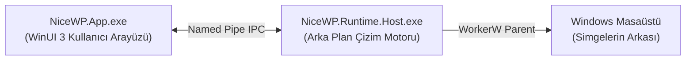
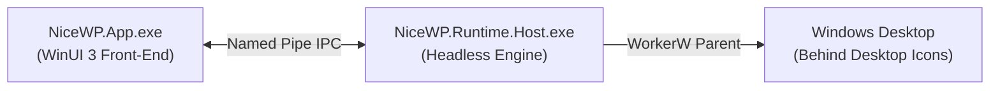

# NiceWallpaper (NiceWP)

> **Windows için hafif, akıllı ve kişiselleştirilebilir statik/video duvar kâğıdı yöneticisi.**  
> *Modern, resource-conscious dynamic wallpaper engine for Windows 10 & 11.*

[-blue.svg)](#desteklenen-windows-sürümleri)
[](https://dotnet.microsoft.com/)
[](https://github.com/microsoft/WindowsAppSDK)

[🇹🇷 Türkçe](#-türkçe) · [🇬🇧 English](#-english)

---

<a id="-türkçe"></a><a id="turkce"></a>
# 🇹🇷 Türkçe

## Genel Bakış

NiceWallpaper (NiceWP), Windows masaüstü için geliştirilmiş hafif ve performans odaklı bir duvar kâğıdı yöneticisidir.

Statik yüksek çözünürlüklü görsellerin ve video duvar kâğıtlarının masaüstü simgelerinin arkasında sorunsuz çalıştırılmasının yanı sıra; kullanım bağlamına göre seçim yapan **Smart Scenes**, açık lisanslı çevrim içi içeriklere erişim sağlayan **Discover**, tamamen yerel **Kişiselleştirme Motoru** ve etkileşimli **Page Turn** gibi modern özellikler sunar.

Geleneksel duvar kâğıdı uygulamaları arka planda sürekli ve yüksek CPU/GPU tüketimine yol açabilirken, NiceWP iki ayrı süreçten oluşan yalıtılmış bir mimari kullanır (`NiceWP.App` kullanıcı arayüzü, `NiceWP.Runtime.Host` masaüstü çizim motoru). Olay güdümlü güç politikaları sayesinde tam ekran oyunlar, filmler veya pil tasarrufu modu devreye girdiğinde video oynatımı otomatik olarak duraklatılır veya derin dondurmaya (deep freeze) alınır; sisteminize sıfır çizim yükü biner.

---

## Özellikler

- **Statik ve Video Duvar Kâğıtları**: Yüksek çözünürlüklü resim (JPG, PNG, WEBP, BMP) ve donanım hızlandırmalı video (MP4, WEBM) desteği.
- **Windows Masaüstü / WorkerW Entegrasyonu**: Windows masaüstü simgelerinin arkasında yerel Win32 hook'ları aracılığıyla çizim yapar; görev çubuğunu veya simgeleri etkilemez.
- **Etkileşimli Page Turn**: Ekranın sağ alt köşesinden sürükleme hareketiyle 60 FPS hızında gerçek zamanlı sayfa kıvrılma efekti; sonraki duvar kâğıdını uygulamadan önce canlı önizleme imkânı.
- **Adaptive Desktop Intelligence**: Gerçek zamanlı sistem ortamı algılama, pil tasarrufu koruması ve tam ekran oyun/sunum sırasında otomatik duraklatma.
- **Smart Scenes**: ITU-R BT.709 parlaklık analizi, renk sıcaklığı tespiti ve bağlama uygun akıllı seçim (Odak / Focus, Oyun / Gaming, Dinlenme / Relax, Gece / Night, Pil Tasarrufu / Battery Saver).
- **Discover / Çevrim İçi Kütüphane**: Openverse, Wikimedia Commons ve NASA Image and Video Library üzerinden açık lisanslı, yüksek kaliteli duvar kâğıtlarını doğrudan arama ve indirme; tam kaynak ve lisans (provenance) kaydı.
- **Smart Collections ve Favoriler**: Duvar kâğıtlarını etiketlere, çözünürlüklere ve favorilere göre düzenleme.
- **Yerel Kişiselleştirme Motoru (Local-only Personalization)**: Bulut ve telemetri olmadan deterministik zevk öğrenimi ("Buna Benzer Daha Çok", "Buna Benzer Daha Az", "Bir Daha Gösterme", favori ağırlıklandırması) ve zamanla yumuşayan tercih sönümlemesi.
- **Performans ve Kaynak Yönetimi**: Sıfır hot-path bellek ayırımı, sınırlı LRU bellek önbelleği ve kullanılmayan kaynaklar için derin dondurma (deep freeze).
- **İki Dilli Arayüz**: Türkçe ve İngilizce dilleri arasında anında geçiş desteği.
- **Sistem Tepsisi (Tray) ve Tek Örnek (Single Instance)**: Sessiz arka plan başlangıcı ve hafif sistem tepsisi menüsü.

---

## İndir

En güncel sürüm: **[NiceWP 0.0.23 — Public Preview](https://github.com/Cihanak1/NiceWP/releases/tag/v0.0.23)**

| Paket Türü | Dosya Adı | Açıklama |
| :--- | :--- | :--- |
| **Kurulum (Önerilen)** | `NiceWP-0.0.23-win-x64-Setup.exe` | Çoğu kullanıcı için önerilen yöntem. Başlat menüsü ve masaüstü kısayollarını otomatik yapılandırır. |
| **Taşınabilir (Portable)** | `NiceWP-0.0.23-win-x64.zip` | Kurulum gerektirmez. Arşivi dilediğiniz klasöre çıkarıp doğrudan çalıştırabilirsiniz. |

> [!NOTE]
> - İndirilen dosyaların bütünlüğünü doğrulamak için GitHub Release sayfasında `SHA256SUMS.txt` dosyası yer almaktadır.
> - Kurulum dosyası şu anda dijital olarak imzalanmamıştır (unsigned). Windows SmartScreen uyarısı görüntülendiğinde "Ek bilgi" -> "Yine de çalıştır" seçeneğini kullanabilirsiniz.

---

## Ekran Görüntüleri

> Temiz arayüz yakalamaları için [`docs/release-screenshot-plan.md`](docs/release-screenshot-plan.md) belgesini inceleyebilirsiniz.

| Kütüphane Görünümü | Aktif Duvar Kâğıdı ve Kişiselleştirme |
| :---: | :---: |
| `docs/images/01_library_view.png` | `docs/images/02_active_wallpaper.png` |

| Discover / Çevrim İçi Kütüphane | Smart Scenes ve Ayarlar |
| :---: | :---: |
| `docs/images/03_discover_view.png` | `docs/images/04_settings_view.png` |

---

## Kurulum

### Kurulum Sihirbazı ile Kurulum (Önerilen)
1. [Releases](https://github.com/Cihanak1/NiceWP/releases) sayfasından `NiceWP-0.0.23-win-x64-Setup.exe` dosyasını indirin.
2. Kurulum sihirbazını çalıştırın.
3. Uygulama `%LocalAppData%\Programs\NiceWP` dizinine yönetici yetkisi gerektirmeden kurulacaktır.

### Taşınabilir (Portable) ZIP
1. `NiceWP-0.0.23-win-x64.zip` dosyasını indirin.
2. Arşivi istediğiniz bir klasöre çıkartın.
3. `NiceWP.App.exe` dosyasını çalıştırın.

---

## Desteklenen Windows Sürümleri

- **Windows 11**: Tüm sürümler (x64)
- **Windows 10**: Sürüm 1809 (Build 17763) veya üzeri (x64) (Önerilen: Sürüm 2004 / Build 19041+)
- **Mimari**: Yalnızca 64-bit (x64) (Windows 11 üzerinde ARM64 emülasyonu desteklenir)

---

## Nasıl Çalışır?

NiceWP, kullanıcı arayüzü ile masaüstü çizim işlemlerini birbirinden yalıtılmış iki ayrı süreç halinde yürütür:



1. **`NiceWP.App.exe`**: WinUI 3 yönetim arayüzü. Kütüphane yönetimi, Discover aramaları, ayarlar ve sistem tepsisi entegrasyonunu sunar.
2. **`NiceWP.Runtime.Host.exe`**: Bağımsız çizim motoru. Windows Explorer'ın `WorkerW` penceresine bağlanarak DirectComposition ve donanım hızlandırmalı video çözümleyicilerini yönetir. Yönetim uygulaması kapatılsa dahi duvar kâğıdı kesintisiz çalışmayı sürdürür.
3. **Kabuk Kurtarma (Shell Recovery)**: Windows Gezgini yeniden başladığında (`WM_TASKBARCREATED`), motor otomatik olarak masaüstü pencere tanıtıcısını yeniden elde eder, duvar kâğıdını geri yükler ve sistem tepsisi simgesini yeniden kaydeder.

---

## Smart Scenes

Smart Scenes, kütüphanenizdeki duvar kâğıtlarını ortam ve sistem bağlamınızla sürekli eşleştirir:
- **Odak (Focus)**: Dikkat dağınıklığını en aza indirmek için düşük hareketli, sade ve hafif kaynak tüketen duvar kâğıtlarını tercih eder.
- **Oyun (Gaming)**: GPU kare hızını korumak için video oynatımını otomatik duraklatır ve yüksek maliyetli ögeleri eler.
- **Dinlenme (Relax)**: Sıcak tonlu, dinlendirici statik veya hafif hareketli görselleri öne çıkarır.
- **Gece (Night)**: Akşam saatlerinde göz yorgunluğunu azaltmak amacıyla koyu ve düşük parlaklıklı duvar kâğıtlarını seçer.
- **Pil Tasarrufu (Battery Saver)**: Video çözümleyicilerini tamamen durdurur ve statik, düşük kaynak tüketen duvar kâğıtlarına geçer.

---

## Discover / Keşfet

Discover sekmesi, internet üzerinden yüksek kaliteli ve açık lisanslı duvar kâğıtlarına doğrudan erişim sağlar:
- **Desteklenen Kaynaklar**:
  - Openverse
  - Wikimedia Commons
  - NASA Image and Video Library
- **Bağımsız İçerik Sağlayıcı Politikası**: NiceWP bu kurum veya servislerle resmi bir ortaklık, sponsorluk veya onay ilişkisi iddia etmez; bu platformlar yalnızca herkese açık içerik sağlayıcıları olarak kullanılır.
- **Kaynak ve Lisans Korunumu (Provenance)**: İndirilen her duvar kâğıdının üreticisi, kaynak URL'si ve lisans bilgileri yerel veritabanında saklanır ve kütüphane detaylarında görüntülenebilir.

---

## Kişiselleştirme

NiceWP, bulut servislerine veya yapay zekâ sunucularına ihtiyaç duymadan görsel tercihlerinizi öğrenir:
- **Kullanıcı Geri Bildirim Sinyalleri**: "Buna Benzer Daha Çok" (More Like This) veya "Buna Benzer Daha Az" (Less Like This) seçenekleri duvar kâğıdı ağırlıklarını ($\pm 0.20$) ve görsel öznitelik eğilimlerini ($\pm 0.08$) ayarlar.
- **Hariç Tutma ("Bir Daha Gösterme")**: İstemediğiniz bir duvar kâğıdını tek tıkla otomatik rotasyondan kalıcı olarak çıkarabilirsiniz.
- **Zamanla Yumuşayan Sönümleme (Lazy Timestamp Decay)**: Eski tercihler aylar içinde nötr düzeye doğru yavaşça gevşer ($1.0 \rightarrow 0.85 \rightarrow 0.60 \rightarrow 0.20$).
- **Sistem Önceliği**: Ortam güvenlik kısıtlamaları kişisel tercihlerin önündedir (örneğin Pil Tasarrufu devredeyken video tercih puanı daima $\le 0.0$ olur).

---

## Performans ve Kaynak Yönetimi

- **Sıfır Hot-Path Bellek Ayırımı**: Etkileşimli Page Turn mekanizması, önceden ölçeklendirilmiş yüzey önbellekleri ve yeniden kullanılabilir bellek arabellekleri ile çalışır.
- **Sınırlı Bellek Önbelleği (LRU)**: Discover sekmesindeki çevrim içi küçük resimler sınırlı bir LRU bellek önbelleği (`DecodePixelWidth=360`) ile yüklenir, kaydırma sırasında bellek sızıntısı oluşmasını engeller.
- **Derin Dondurma (Deep Freeze)**: 60 saniye boyunca askıda kalan video oynatıcıları tüm donanım kaynaklarını sisteme geri iade eder.

---

## Gizlilik

NiceWP yerel öncelikli (local-first) bir gizlilik anlayışını benimser:
- **Telemetri Yok**: Kullanıcı davranışı izlenmez, donanım kimliği toplanmaz, analiz araçları bulunmaz.
- **Yerel Kişiselleştirme**: Tüm tercih verileri yalnızca yerel ortamınızda saklanır (`%LocalAppData%\NiceWP\personalization.json`).
- **Şeffaf Ağ İstekleri**: Çevrim içi arama sorguları yalnızca Discover özelliği kullanıldığında ve doğrudan resmi sağlayıcı API'lerine HTTPS üzerinden gönderilir.
- Ayrıntılı bilgi için [`docs/privacy.md`](docs/privacy.md) belgesini inceleyebilirsiniz.

---

## Kaynak Koddan Derleme

### Gereksinimler
- Windows 10/11 x64
- [.NET 10.0 SDK](https://dotnet.microsoft.com/)
- [Inno Setup 6](https://jrsoftware.org/isinfo.php) (isteğe bağlı, kurulum dosyası üretimi için)

### Derleme Komutları
```powershell
# Depoyu klonlayın
git clone https://github.com/Cihanak1/NiceWP.git
cd NiceWP

# Paketleri geri yükleyin ve Release modunda derleyin
dotnet restore NiceWallpaper.sln
dotnet build NiceWallpaper.sln -c Release -p:Platform=x64

# Test paketini çalıştırın
dotnet test NiceWallpaper.sln -c Release -p:Platform=x64

# Taşınabilir paket ve kurulum dosyası üretin
powershell -ExecutionPolicy Bypass -File build.ps1 -OutputDir ".artifacts\dist\NiceWP-0.0.23-win-x64" -CreateInstaller
```

---

## Bilinen Sınırlamalar

- **Çoklu Monitör**: Duvar kâğıtları şu anda birincil ekranda görüntülenir; bağımsız çoklu monitör ataması gelecek sürümlerde tamamlanacaktır.
- **Platform**: Yalnızca Windows 10 ve 11 (x64) için tasarlanmıştır.
- **Page Turn**: Çok düşük seviyeli dahili grafik birimlerinde (integrated GPU) hızlı fare sürüklemelerinde nadir mikro takılmalar görülebilir.
- **Çevrim İçi Sağlayıcılar**: Discover arama erişilebilirliği ve yanıt süreleri üçüncü taraf sağlayıcı sunucularına bağlıdır.
- **Kod İmzası**: Kurulum dosyası şu anda dijital sertifika ile imzalanmamıştır.

---

## Üçüncü Taraf Bildirimleri

Kullanılan açık kaynak paketler, çalışma zamanı bağımlılıkları ve çevrim içi içerik sağlayıcı lisanslarına ilişkin ayrıntılar için [`THIRD_PARTY_NOTICES.md`](THIRD_PARTY_NOTICES.md) dosyasına bakabilirsiniz.

---

## Katkıda Bulunma

Hata bildirimleri, özellik önerileri ve geri bildirimler için [GitHub Issues](https://github.com/Cihanak1/NiceWP/issues) bölümünü kullanabilirsiniz.

---

## Lisans

Proje için henüz bir açık kaynak lisansı seçilmemiştir. Kaynak kodun GitHub üzerinde erişilebilir olması, otomatik olarak yeniden kullanım veya dağıtım hakkı vermez.

Tüm hakları saklıdır. Copyright (c) 2026 NiceWP Team.

---

<a id="-english"></a><a id="english"></a>
# 🇬🇧 English

## Overview

NiceWallpaper (NiceWP) is a desktop wallpaper manager engineered specifically for Windows. It provides smooth static image and hardware-accelerated video wallpapers directly beneath desktop icons, pairing an **Interactive Page Turn** gesture with an **Adaptive Desktop Intelligence** runtime, **Smart Scenes**, **Discover / Online Library**, and a **100% Local Personalization Engine**.

Unlike traditional wallpaper utilities that incur heavy continuous background CPU/GPU usage, NiceWP utilizes an isolated two-process architecture (`NiceWP.App` for UI, `NiceWP.Runtime.Host` for desktop rendering) with event-driven power policies. When games, fullscreen movies, or battery saver modes are active, wallpapers automatically pause or enter deep freeze, returning zero rendering load to your system.

---

## Features

- **Static & Video Wallpapers**: High-resolution image (JPG, PNG, WEBP, BMP) and hardware-decoded video (MP4, WEBM) desktop integration.
- **WorkerW Desktop Host**: Renders behind Windows desktop icons using native Win32 message hooks without overlay artifacts or taskbar interference.
- **Interactive Page Turn**: Global corner drag gesture featuring a 60 FPS real-time page curl visual overlay to preview and switch wallpapers fluidly.
- **Adaptive Desktop Intelligence**: Real-time environmental profiling, battery saver guardrails, and automated pause policies during fullscreen gaming or presentation.
- **Smart Scenes**: ITU-R BT.709 perceived luminance analysis, color temperature detection, and context-aware selection (Focus, Gaming, Relax, Night, Battery Saver).
- **Discover / Online Library**: Search and download high-quality, open-license wallpapers from Openverse, Wikimedia Commons, and NASA Image and Video Library with complete provenance retention.
- **Smart Collections & Favorites**: Organize wallpapers by resolution, tags, and favorites.
- **Local Personalization Engine**: Deterministic taste learning ("More Like This", "Less Like This", "Never Show Again", favorites scoring) with lazy timestamp decay and zero telemetry.
- **Performance & Resource Guard**: Zero hot-path allocations, bounded LRU thumbnail cache, and deep freeze for idle video renderers.
- **Bilingual Interface**: Native support for English and Turkish with instant language switching.
- **System Tray & Single Instance**: Lightweight system tray companion with quiet background startup.

---

## Download

Latest release: **[NiceWP 0.0.23 — Public Preview](https://github.com/Cihanak1/NiceWP/releases/tag/v0.0.23)**

| Package | Filename | Description |
| :--- | :--- | :--- |
| **Installer (Recommended)** | `NiceWP-0.0.23-win-x64-Setup.exe` | Recommended for most users. Automatically configures desktop and start menu shortcuts. |
| **Portable ZIP** | `NiceWP-0.0.23-win-x64.zip` | No installer required. Extract to any directory and run directly. |

> [!NOTE]
> - Package integrity can be verified against `SHA256SUMS.txt` available in the GitHub Release assets.
> - The installer is currently unsigned. If prompted by Windows SmartScreen, click "More info" -> "Run anyway".

---

## Screenshots

> See [`docs/release-screenshot-plan.md`](docs/release-screenshot-plan.md) for clean captures of the primary views.

| Library View | Active Wallpaper & Personalization |
| :---: | :---: |
| `docs/images/01_library_view.png` | `docs/images/02_active_wallpaper.png` |

| Discover Online Library | Smart Scenes & Settings |
| :---: | :---: |
| `docs/images/03_discover_view.png` | `docs/images/04_settings_view.png` |

---

## Installation

### Installer (Recommended)
1. Download `NiceWP-0.0.23-win-x64-Setup.exe` from the [Releases](https://github.com/Cihanak1/NiceWP/releases) page.
2. Run the setup wizard.
3. Installs to `%LocalAppData%\Programs\NiceWP` (requires no administrator privileges).

### Portable ZIP
1. Download `NiceWP-0.0.23-win-x64.zip`.
2. Extract to any folder.
3. Run `NiceWP.App.exe`.

---

## Supported Windows Versions

- **Windows 11**: All editions (x64)
- **Windows 10**: Version 1809 (Build 17763) or higher (x64) (Recommended: Version 2004 / Build 19041+)
- **Architecture**: x64 (ARM64 emulation supported via Windows 11 compatibility)

---

## How It Works

NiceWP separates management from presentation across two isolated processes:



1. **`NiceWP.App.exe`**: WinUI 3 management client. Provides the user interface, library browsing, discover queries, settings, and tray integration.
2. **`NiceWP.Runtime.Host.exe`**: Headless engine. Connects to Explorer's `WorkerW` window handle, managing DirectComposition and hardware video decoders. If the management application closes, the wallpaper engine continues running seamlessly.
3. **Resilience & Shell Recovery**: On Windows Explorer restarts (`WM_TASKBARCREATED`), the engine automatically reacquires the desktop handle, restores the wallpaper, and re-registers the tray icon.

---

## Smart Scenes & Contextual Scoring

Smart Scenes continuously matches candidate wallpapers with your environmental state:
- **Focus**: Prefers darker, low-motion wallpapers with light resource footprints to minimize distraction.
- **Gaming**: Forces heavy video playback to pause and penalizes high-cost items to protect GPU frame pacing.
- **Relax**: Prefers warm-toned, calming static or subtle-motion wallpapers.
- **Night**: Prefers dark, low-brightness wallpapers to reduce eye strain during evening hours.
- **Battery Saver**: Automatically halts video decoders and selects static, light-resource wallpapers.

---

## Discover / Online Library

The Discover tab provides integrated search and download access to high-quality, open-license wallpapers:
- **Supported Sources**:
  - Openverse
  - Wikimedia Commons
  - NASA Image and Video Library
- **Provider Policy**: NiceWP does not claim any partnership, affiliation, or endorsement with these services; they are utilized strictly as public content providers.
- **Provenance & Licensing**: Downloaded wallpaper provenance, author attribution, and license details are preserved locally and viewable in the library.

---

## Personalization Engine

NiceWP learns your aesthetic taste without cloud services:
- **Feedback Signals**: Direct actions ("More Like This", "Less Like This") nudge item weights ($\pm 0.20$) and visual feature tendencies ($\pm 0.08$).
- **Exclusion ("Never Show Again")**: Excludes unwanted wallpapers from automatic rotations with a single click.
- **Lazy Timestamp Decay**: Stale preferences gently relax toward neutral over months ($1.0 \rightarrow 0.85 \rightarrow 0.60 \rightarrow 0.20$ floor).
- **Scene Priority**: Environmental safety constraints strictly override personal taste (e.g. Battery Saver forces video preference scores to $\le 0.0$).

---

## Performance & Resource Guard

- **Zero Hot-Path Allocations**: Interactive Page Turn uses reusable memory buffers and pre-scaled surface caches.
- **Bounded Discover Cache**: Online search thumbnails are capped with an LRU memory cache (`DecodePixelWidth=360`), preventing memory climbing during extensive scrolling.
- **Deep Freeze**: Unused video renderers release hardware resources after 60 seconds of continuous suspension.

---

## Privacy Policy

NiceWP is local-first:
- **No Telemetry**: Zero user tracking, zero hardware IDs, zero analytics.
- **Local Personalization**: All preference data is stored strictly in `%LocalAppData%\NiceWP\personalization.json`.
- **Transparent Discover Queries**: Online search queries are sent directly over HTTPS to official provider APIs (Openverse, Wikimedia, NASA).
- See [`docs/privacy.md`](docs/privacy.md) for complete details.

---

## Building from Source

### Prerequisites
- Windows 10/11 x64
- [.NET 10.0 SDK](https://dotnet.microsoft.com/)
- [Inno Setup 6](https://jrsoftware.org/isinfo.php) (optional, for installer creation)

### Build Commands
```powershell
# Clone the repository
git clone https://github.com/Cihanak1/NiceWP.git
cd NiceWP

# Restore and build in Release mode
dotnet restore NiceWallpaper.sln
dotnet build NiceWallpaper.sln -c Release -p:Platform=x64

# Run the test suite
dotnet test NiceWallpaper.sln -c Release -p:Platform=x64

# Package portable distribution and installer
powershell -ExecutionPolicy Bypass -File build.ps1 -OutputDir ".artifacts\dist\NiceWP-0.0.23-win-x64" -CreateInstaller
```

---

## Known Limitations

- **Multi-Monitor**: Wallpapers currently target the primary display; full independent multi-monitor assignment is slated for a future milestone.
- **Platform**: Designed exclusively for Windows 10 & 11 (x64).
- **Page Turn**: On very low-end GPUs or power-saving integrated graphics, occasional micro-stutter may occur during fast mouse gesture drags.
- **Online Providers**: Search availability and latency depend on third-party public API endpoints.
- **Code Signing**: The installer package is currently unsigned.

---

## Third-Party Notices & Attribution

See [`THIRD_PARTY_NOTICES.md`](THIRD_PARTY_NOTICES.md) for complete details on open-source packages, runtime dependencies, and online content provider licensing.

---

## Contributing

Bug reports, feature suggestions, and feedback are welcome through [GitHub Issues](https://github.com/Cihanak1/NiceWP/issues).

---

## License

No open-source license has been selected for this project yet. Having the source code accessible on GitHub does not automatically grant rights for reuse or redistribution.

All rights reserved. Copyright (c) 2026 NiceWP Team.
