# NiceWP — Discover / Online Library (0.0.20)

> *"Find it. Add it. NiceWP handles the rest."*  
> *(TR: "Bul. Kütüphanene ekle. Gerisini NiceWP halletsin.")*

---

## 1. Overview

NiceWP 0.0.20 extends the **Library** surface with an integrated **Discover (Keşfet)** experience. Users can search, browse, preview, and import high-resolution, open-licensed wallpapers from verified public sources with one-click simplicity.

Once imported, an online wallpaper instantly converts into a first-class local NiceWP wallpaper—automatically analyzed by the **0.0.19 Smart Scenes** engine, classified by color temperature and luminance, and immediately integrated into Smart Collections and Smart Rotation.

---

## 2. Architecture & Pipeline

```mermaid
flowchart TD
    UserQuery["User Search / Presets / Filters"] --> DiscoverService["WallpaperDiscoverService\n(Bounded Concurrency & Cache)"]
    DiscoverService --> Cache["WallpaperDiscoverCache\n(%LocalAppData%\\NiceWP\\discover-cache)"]
    DiscoverService --> Openverse["OpenverseWallpaperProvider\n(CC Search API)"]
    DiscoverService --> Wikimedia["WikimediaWallpaperProvider\n(Action Query & ExtMetadata)"]
    DiscoverService --> NASA["NasaWallpaperProvider\n(Images & Video API)"]
    
    Openverse --> Aggregator["Result Aggregator & Interleaver\n(Deduplication & License Whitelist)"]
    Wikimedia --> Aggregator
    NASA --> Aggregator
    
    Aggregator --> UI["DesktopTestWindow\n(Discover Grid, Card Preview, Download Bar)"]
    UI --> Downloader["OnlineWallpaperDownloader\n(SSRF Guard, Size Bounding, Magic Bytes)"]
    Downloader --> Storage["%LocalAppData%\\NiceWP\\Library\\Online\\{Provider}\\"]
    Storage --> LibraryService["WallpaperLibraryService\n(library.json with WallpaperOrigin)"]
    LibraryService --> SmartScenes["WallpaperAnalysisService\n(Smart Scenes 0.0.19 Integration)"]
```



---

## 3. Provider Whitelist & Safety Policy

NiceWP enforces an explicit, auditable provider policy defined in `OnlineProviderPolicy.cs`. Only verified open-license repositories with friendly API terms are permitted.

### 3.1 Approved Production Providers

| Provider | Organization / Ecosystem | Permitted Content | Features Supported |
| :--- | :--- | :--- | :--- |
| **Openverse** | WordPress Foundation | Free Cultural Works & Public Domain images | Keywords, Orientation, Aspect Ratio, License filtering, Safe Search |
| **Wikimedia Commons** | Wikimedia Foundation | Educational & Cultural open-license media | Keywords, High-resolution bitmaps, Full artist attribution, Category search |
| **NASA Image & Video Library** | NASA / US Government | Public Domain space exploration media | Space photography, Launch clips, 4K nebula imagery, Free US Gov Works |

### 3.2 Explicitly Prohibited Providers & Legal Rationale

NiceWP deliberately omits and strictly forbids the following providers to protect users and preserve ethical open-source standards:

- **Unsplash**: Section 2.a of the Unsplash API Terms explicitly prohibits applications that replicate Unsplash's core experience or operate as standalone wallpaper downloaders without prior written enterprise approval.
- **Pexels**: Section 2.4 of the Pexels API Terms prohibits using the API for standalone wallpaper applications where wallpaper delivery is the sole or primary purpose.
- **Pixabay**: The Pixabay Content License restricts mass redistributing unaltered images on wallpaper services.
- **Wallhaven**: Wallhaven relies on community-submitted content without automated or uniform open-access copyright verification.
- **Web Scraping**: NiceWP prohibits any unauthorized scraping of wallpaper aggregators. Only documented, authenticated, or public APIs are used.

Unit tests in `DiscoverTests.cs` verify that excluded providers cannot be activated and return policy explanation strings.

---

## 4. License Policy & Provenance Tracking

NiceWP standardizes third-party licenses into strict safety tiers via `WallpaperLicensePolicy.cs`.

### 4.1 Permitted License Whitelist (Default Discover)

1. **Public Domain / PDM**: Unconditional personal and commercial use; no copyright restrictions.
2. **CC0 (Creative Commons Zero 1.0)**: Complete worldwide copyright dedication.
3. **CC BY (Attribution 2.0 – 4.0)**: Permitted with proper creator credit.
4. **CC BY-SA (Attribution-ShareAlike 2.0 – 4.0)**: Permitted with creator credit and reciprocal licensing.

### 4.2 Excluded Licenses

- **CC BY-NC / NonCommercial**: Excluded from default Discover view.
- **CC BY-ND / NoDerivatives**: Excluded from default Discover view.
- **All Rights Reserved / Unknown**: Strictly rejected.

### 4.3 Provenance Persistence (`WallpaperOrigin`)

When a wallpaper is downloaded, NiceWP persists its complete origin and attribution metadata in `%LocalAppData%\NiceWP\library.json`:

```json
{
  "id": "c71a39f041...",
  "type": "image",
  "filePath": "C:\\Users\\...\\AppData\\Local\\NiceWP\\Library\\Online\\openverse\\majestic-mountain.jpg",
  "displayName": "Majestic Mountain Peaks",
  "origin": {
    "sourceType": "Online",
    "provider": "openverse",
    "remoteId": "openverse-item-1",
    "originalUrl": "https://openverse.org/image/openverse-item-1",
    "creator": "Jane Doe",
    "creatorUrl": "https://example.com/jane",
    "license": "CC BY",
    "licenseUrl": "https://creativecommons.org/licenses/by/4.0/",
    "attributionText": "\"Majestic Mountain Peaks\" by Jane Doe is licensed under CC BY 4.0",
    "downloadedAtUtc": "2026-10-23T10:15:00Z"
  }
}
```

The user can view the creator, license badge, and attribution link directly inside the wallpaper details dialog.

---

## 5. Security & Network Hardening

### 5.1 SSRF & Insecure URL Prevention

All network downloads are handled through `OnlineWallpaperDownloader` and `NetworkSafetyValidator`:
- **HTTPS Only**: Plain HTTP URLs are rejected immediately.
- **IP Address Validation**: Hostnames resolving to private RFC 1918 addresses (`10.0.0.0/8`, `172.16.0.0/12`, `192.168.0.0/16`), loopback (`127.0.0.1`), link-local (`169.254.0.0/16`), or cloud instance metadata endpoints (`169.254.169.254`) are aborted before initiating the connection.
- **Redirect Revalidation**: HTTP 301/302 redirects are intercepted and re-validated against the SSRF filter before following.

### 5.2 Stream Size Bounds & Resource Guarding

- **Image Limit**: 100 MB max.
- **Video Limit**: 500 MB max.
- Downloads stream directly to temporary storage (`.tmp`). If the payload exceeds the maximum size, the transfer is immediately terminated and the temporary file is deleted.

### 5.3 Magic Bytes Validation (`MediaSignatureDetector`)

File extensions are not trusted blindly. After streaming, NiceWP inspects binary header signatures:
- **JPEG**: `0xFF, 0xD8, 0xFF`
- **PNG**: `0x89, 0x50, 0x4E, 0x47, 0x0D, 0x0A, 0x1A, 0x0A`
- **MP4 / ISO BMFF**: `ftyp` box header validation

Files failing media signature detection are discarded with a safety warning.

---

## 6. Privacy & Performance

- **No User Accounts / Telemetry**: NiceWP transmits no user telemetry, browsing histories, or hardware IDs to provider servers.
- **Safe Content Filtering**: Default search requests include `mature=false` to ensure safe results across all providers.
- **Metadata Caching**: Query results are cached locally in `%LocalAppData%\NiceWP\discover-cache\` with a 20-minute sliding window to comply with provider rate limit guidelines.
- **Offline Resilience**: When no internet connection is detected, the UI gracefully reports `"No internet connection."` without hanging or throwing unhandled exceptions.
- **Duplicate Prevention**: If an item has already been imported into the library, NiceWP detects its existing origin and displays an `"Already in Library"` state without re-downloading.

---

## 7. Verification & Test Coverage

Milestone 0.0.20 is protected by comprehensive regression tests in `DiscoverTests.cs` (52 assertions):
- Whitelist enforcement & rejection of restricted providers (Unsplash, Pexels, Pixabay, Wallhaven).
- License evaluation for CC0, CC BY, CC BY-SA, PDM, CC BY-NC, CC BY-ND, and Unknown.
- Openverse HTTP 429 rate limit backoff and JSON mapping.
- Wikimedia Commons HTML sanitization and MediaWiki query parser.
- NASA rights filtering excluding commercial and third-party copyright claims.
- Bounded concurrency, deduplication, and cache TTL verification.
- SSRF prevention rejecting localhost, private RFC 1918 IPs, and cloud metadata IPs.
- Media signature magic bytes validation and safe filename generation.
- Full provenance metadata persistence and library reloading.
