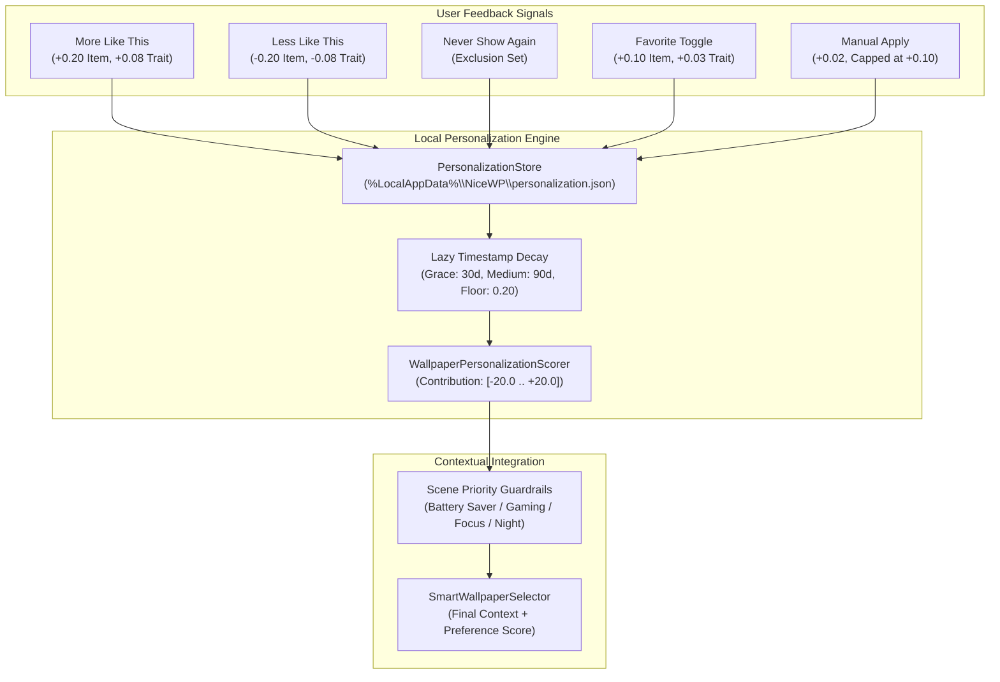
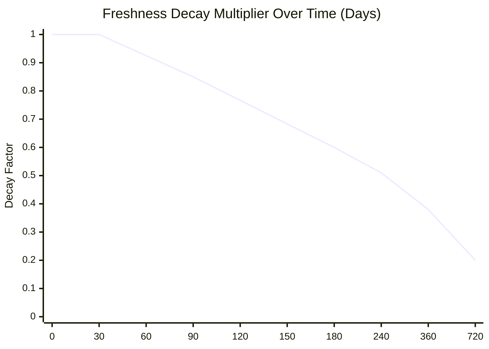

# NiceWP — Personalization Engine (0.0.22)

> *"Your desktop learns your taste — 100% locally, deterministically, and explainably."*

---

## 1. Overview & Objectives

In Milestone 0.0.19 (*Smart Scenes*), NiceWP gained the ability to evaluate ambient desktop context (battery state, active gaming/focus/relax profiles, time of day) and select appropriate wallpapers. However, choices were based solely on generalized context rules rather than user-specific taste.

NiceWP **0.0.22 — Personalization Engine** bridges this gap:
- Enables users to steer recommendations via explicit feedback: **"More Like This"**, **"Less Like This"**, and **"Never Show Again"**.
- Gently learns implicit taste from favorites toggling and deliberate manual selections.
- Seamlessly blends personal taste with environmental Smart Scenes scoring.
- **Zero Cloud / Telemetry**: 100% local, deterministic, mathematically bounded, fully explainable, and instantaneously resettable.

---

## 2. Core Architecture & Data Contracts

### 2.1 Persistence & Data Minimization
All personalization state is stored exclusively in a single JSON file on the local machine:
- **Path**: `%LocalAppData%\NiceWP\personalization.json`
- **Atomic File Writing**: Saves write through temporary staging files (`personalization.json.tmp`) with atomic replacement to prevent data loss on unexpected shutdown or power loss.
- **Corrupt Profile Quarantine**: If the file becomes corrupted or malformed, it is automatically backed up to `personalization.json.<timestamp>.bak` and a clean default profile is initialized without application crash.
- **Write Debouncing**: Fast consecutive feedback actions are debounced with a 750 ms trailing timer to protect SSD endurance and prevent UI hitching.

### 2.2 Profile Schema
The profile consists of four primary components:
1. `WallpaperPreferences`: Direct per-item scores indexed by stable `WallpaperId` (`Weight` clamped to $[-1.0, +1.0]$, interaction timestamp, manual apply count).
2. `FeatureWeights`: Bounded continuous feature preferences clamped to $[-1.0, +1.0]$:
   - Brightness: `DarkPreference`, `LightPreference`
   - Media Type: `StaticPreference`, `VideoPreference`
   - Motion: `LowMotionPreference`, `HighMotionPreference`
   - Color Temperature: `WarmPreference`, `NeutralPreference`, `CoolPreference`
   - Resource Class: `LightResourcePreference`, `ModerateResourcePreference`, `HeavyResourcePreference`
3. `ExcludedWallpaperIds`: Set of wallpaper IDs excluded from all automatic rotations.
4. `InteractionSummary`: High-level statistics for diagnostic summaries and UI explanation cards.

---

## 3. Feedback Signals & Learning Policies

| Signal | Item Weight Delta | Trait Weights Delta | Target Scope |
| :--- | :---: | :---: | :--- |
| **More Like This** | `+0.20` | `+0.08` | Active wallpaper & analyzed visual traits |
| **Less Like This** | `-0.20` | `-0.08` | Active wallpaper & analyzed visual traits |
| **Never Show Again** | Marked Excluded | `0.00` | Excluded from Smart Scenes & automatic rotation |
| **Favorite Toggled On** | `+0.10` | `+0.03` | Active wallpaper & analyzed visual traits |
| **Favorite Toggled Off** | `-0.10` | `-0.03` | Active wallpaper & analyzed visual traits |
| **Manual Selection** | `+0.02` (Max 5×) | `+0.02` (Max 3×) | User-initiated double-click or "Set as Wallpaper" |

### 3.1 Passive Learning Guardrails
- **Manual Selection Cap**: Manual selections gently nudge wallpapers with `+0.02`, capping out at `+0.10` after 5 manual applies. Automatic rotation cycles and startup restorations **never** trigger manual learning.
- **Feature Clamping**: Every modification strictly clamps all weights within $[-1.0, +1.0]$ using `ClampAll()`, preventing mathematical drift or runaway preferences.

---

## 4. Lazy Timestamp Decay Model

Preferences relax gradually toward neutral over time to allow natural changes in user taste without sudden resets.

- **0 – 30 Days (Grace Period)**: Multiplier is `1.0` (100% full strength).
- **30 – 90 Days (Gentle Decay)**: Linear relaxation from `1.0` down to `0.85` (15% reduction).
- **90 – 180 Days (Moderate Decay)**: Linear relaxation from `0.85` down to `0.60`.
- **> 180 Days (Long-Term Floor)**: Smooth asymptotic decay toward an irreducible floor of `0.20`.
- **Zero Startup Overhead**: Evaluated lazily when calculating candidate scores; never executes heavy background file rewrites on startup.

---

## 5. Scoring Formulation & Environmental Guardrails

### 5.1 Personalization Contribution
Candidate wallpapers receive an additive adjustment $P \in [-20.0, +20.0]$ to their Smart Scenes score:

$$P = \text{Clamp}\Big(W_{\text{direct}} + W_{\text{media}} + W_{\text{bright}} + W_{\text{motion}} + W_{\text{color}} + W_{\text{cost}}, -20.0, +20.0\Big)$$

- $W_{\text{direct}} = \text{Round}(\text{DecayedItemWeight} \times 10.0, 1)$ $\rightarrow$ up to $\pm 10.0$ pts
- $W_{\text{media}} = \text{Round}(\text{MediaWeight} \times 3.0, 1)$ $\rightarrow$ up to $\pm 3.0$ pts
- $W_{\text{bright}} = \text{Round}(\text{BrightnessWeight} \times 3.0, 1)$ $\rightarrow$ up to $\pm 3.0$ pts
- $W_{\text{motion}} = \text{Round}(\text{MotionWeight} \times 3.0, 1)$ $\rightarrow$ up to $\pm 3.0$ pts
- $W_{\text{color}} = \text{Round}(\text{ColorWeight} \times 2.0, 1)$ $\rightarrow$ up to $\pm 2.0$ pts
- $W_{\text{cost}} = \text{Round}(\text{ResourceWeight} \times 3.0, 1)$ $\rightarrow$ up to $\pm 3.0$ pts

### 5.2 Environmental Guardrails (Scene Priority Over Taste)
Environmental and hardware safety rules strictly override user taste:
1. **Battery Saver**: If running on battery or in Battery Saver scene, positive personalization for video or heavy-cost wallpapers is forced to $\le 0.0$.
2. **Gaming Mode**: Positive personalization for heavy-cost wallpapers is forced to $\le 0.0$ to protect CPU/GPU frame pacing.
3. **Focus Mode**: Positive personalization for high-motion wallpapers is forced to $\le 0.0$ to prevent distraction.
4. **Night Mode**: Positive personalization for bright wallpapers is forced to $\le 0.0$ to protect circadian rhythm.

---

## 6. User Interface & Explainability

### 6.1 Active Wallpaper Card
The Active Wallpaper dashboard card displays:
- Contextual score pills (e.g., `+6.4 Personalization`).
- Primary actions:
  - **More Like This** (`ThumbsUp` icon)
  - **Less Like This** (`ThumbsDown` icon)
  - **Never Show Again** (`EyeSlash` / `Dismiss` icon)

### 6.2 Library Card Context Menus
Right-clicking any wallpaper in the library grid exposes:
- **More Like This** / **Less Like This**
- **Never Show Again** / **Allow in Rotation** (if already excluded)
- Clear visual badges denoting excluded wallpapers.

### 6.3 Settings Page
The Settings view includes a dedicated **Personalization** card featuring:
- Master toggle (**Enable Personalization**).
- Granular toggles (**Learn from Favorites**, **Learn from Manual Selections**, **Respect Excluded Wallpapers**).
- **Learned Tendencies Summary**: Summarizes top detected preferences (e.g., *"Prefers dark tones, Low motion, Cool colors"*).
- **Reset Personalization Flow**: Reset button with double-confirmation dialog (`ContentDialog`) that clears the profile back to defaults while preserving library files and favorites intact.
- **Privacy Notice**: Transparently affirms that all personalization data is stored strictly locally without cloud connections, accounts, or telemetry.

---

## 7. Diagnostics & Audit Trail

The personalization service raises structured `PersonalizationAuditEvent` items across all operations:
- `PreferenceIncreased`: Step size, previous weight, new weight.
- `PreferenceDecreased`: Step size, previous weight, new weight.
- `WallpaperExcluded`: Wallpaper ID and exclusion state.
- `WallpaperExclusionRemoved`: Restored to automatic pool.
- `FavoriteToggled`: Associated item weight nudges.
- `ManualWallpaperApplied`: Manual increment and apply count.
- `PersonalizationReset`: Profile reset confirmation.

All events are traced via `System.Diagnostics.Trace` and exposed for in-memory telemetry diagnostics.

---

## 8. Verification & Test Metrics

- **Unit Tests**: 15 new comprehensive tests covering default values, atomic serialization, corrupt profile recovery, decay calculations, bounded scoring, hard constraints suppression, exclusion filtering, manual selections, favorite learning, and summary formatting.
- **Total Suite Passing**: **777 passed, 0 failed, 0 skipped** across the entire solution.
- **Build Status**: 0 warnings, 0 errors in `Release x64`.
