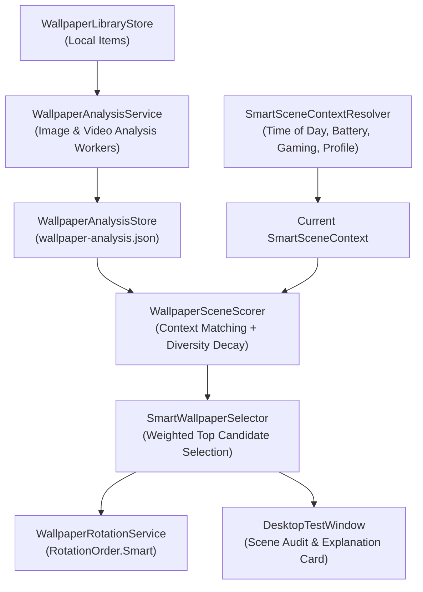

# NiceWP — Smart Scenes (0.0.19)

> *"Your desktop chooses the right wallpaper for the moment."*

---

## 1. Overview
NiceWP 0.0.19 introduces **Smart Scenes**—transforming NiceWP from a traditional static/playlist wallpaper player into an intelligent, context-aware desktop companion.

Rather than rotating wallpapers arbitrarily or demanding complex manual playlist management, NiceWP locally analyzes library items across color temperature, perceived luminance, resolution tier, motion level, and media type. It dynamically evaluates real-time desktop context (time of day, battery saver status, gaming mode, adaptive profile, focus state) and automatically selects the optimal wallpaper to complement the user's current environment.

---

## 2. Architecture & Design Principles

### 2.1 Context & Scoring Pipeline



---

### 2.2 Lightweight Local Wallpaper Analysis

Analysis is strictly local, asynchronous, and designed to minimize system resource usage:
- **`ImageWallpaperAnalyzer`**:
  - Employs downsampled 64&times;64 pixel sampling to calculate perceived luminance via ITU-R BT.709 formulas:
    $$Y = 0.2126 \cdot R + 0.7152 \cdot G + 0.0722 \cdot B$$
  - Analyzes RGB channel ratios to categorize color temperature into `Warm`, `Neutral`, or `Cool`.
  - Determines brightness (`Dark`, `Medium`, `Light`) based on calibrated threshold boundaries.
- **`VideoWallpaperAnalyzer`**:
  - Inspects file container metadata (bitrate, frame dimensions, duration, format).
  - Categorizes motion level into `Low`, `Medium`, or `High` based on bitrate-to-resolution density.
  - Samples video poster frames via thumbnail extraction to establish color temperature and luminance profile.
- **`WallpaperAnalysisService`**:
  - Background worker pool bounded to maximum 2 concurrent threads.
  - Throttled priority; automatically yields during user interaction or high CPU load.

---

### 2.3 Persistent Analysis Store & Cache Invalidation

Analysis results are cached persistently in `%LocalAppData%\NiceWP\wallpaper-analysis.json`:
- **Atomic Persistence**: Serialized through atomic temporary write-and-replace mechanics with UTF-8 encoding.
- **Cache Invalidation**: Each cached entry tracks `FileSize` and `LastModifiedUtc`. If a wallpaper file is replaced or edited on disk, its cached metadata is automatically invalidated and re-analyzed.
- **Missing File Cleanup**: The store provides automated pruning of obsolete records when wallpapers are deleted from the library.

---

### 2.4 Virtual Smart Collections

The library view exposes dynamic, virtual filter collections computed on top of analysis metadata:
- **`Dark`**: Wallpapers with perceived luminance $< 0.40$, ideal for dark workspaces and night environments.
- **`Light`**: Crisp, high-luminance wallpapers for daylight and bright ambient lighting.
- **`Low Resource`**: Highly optimized static imagery and low-bitrate clips that operate within tight memory and CPU envelopes.
- **`High Resolution`**: 1440p, 4K, and ultra-wide wallpapers matched for multi-monitor and high-DPI displays.
- **`Static`**: Pure image media wallpapers.
- **`Video`**: Animated and video wallpapers.
- **`Low Motion`**: Calming, ambient video wallpapers with subtle motion dynamics suitable for deep focus.

---

### 2.5 Smart Scenes & Context Engine

Smart Scenes defines six specialized modes:
1. **`Automatic`**: Dynamically transitions between Focus, Gaming, Relax, Night, and Battery Saver according to real-time system signals.
2. **`Focus`**: Neutral/cool color temperatures, dark or balanced brightness, and low/static motion to eliminate distraction during productivity.
3. **`Gaming`**: Low-resource static or minimal ambient wallpapers that prevent GPU contention with 3D workloads.
4. **`Relax`**: Warm color palettes, serene landscape visuals, and smooth ambient motion.
5. **`Night`**: Deep dark backgrounds with reduced blue light / warm bias to protect circadian rhythms.
6. **`BatterySaver`**: Strictly static, low-complexity images to maximize mobile battery runtime.

**`SmartSceneContextResolver`** evaluates:
- `IsBatterySaver`: Windows power status telemetry.
- `IsGaming`: Adaptive desktop gaming detection.
- `TimeOfDay`: Hour-based sunrise/sunset contextual bands.
- `AdaptiveProfile`: Explicit or automatic adaptive intelligence mode.

---

### 2.6 Contextual Scoring & History Diversity

The scoring engine evaluates candidates on a 0–100 normalized point scale:
- **Base Affinity Score (0–100)**: Evaluates match against active scene rules (brightness, temperature, motion, media type).
- **Favorites Boost (+15 pts)**: User-favorited wallpapers receive priority consideration.
- **Recent Wallpaper Diversity Penalty (-40 pts to -10 pts)**:
  - Last shown wallpaper: -40 points penalty.
  - Wallpapers shown within the last 3 rotations receive decaying penalties (-30, -20, -10).
  - Completely prevents repetitive "stuck" rotations across small library sizes.
- **Score Auditing**: Every candidate generates an explainable breakdown string (e.g., `Score: 85 (Focus Match: +70, Dark Tone: +15, Recent: 0)`).

---

### 2.7 Seamless Rotation Integration (`RotationOrder.Smart`)

- **Rotation Order Extension**: Adds `RotationOrder.Smart` to `RotationOrder.Sequential` and `RotationOrder.Random`.
- **Smart Rotation Setting**: When enabled, the rotation timer queries `SmartWallpaperSelector.SelectBestCandidateAsync()` instead of sequential index incrementing.
- **Graceful Fallback**: If no analyzed items match strict criteria, the selector gracefully relaxes constraints to ensure the rotation sequence never stalls.

---

### 2.8 Explainability & UI Audit

The NiceWP desktop test interface includes real-time explainability:
- **Active Smart Scene Card**: Displays the currently active scene, resolved system context, and active scoring rationale.
- **Collection Filters**: Dropdown selector in the Library view allows instantaneous switching between all Smart Collections.
- **Analysis Status Bar**: Informs user of background analysis progress (`Analyzed 12 of 12 wallpapers (100%)`).

---

## 3. Localization & Configuration

All Smart Scene controls and status strings are fully localized:
- **Turkish (`TurkishResources.cs`)**: Doğal Türkçe, mojibake-free ("Akıllı Sahneler", "Odaklanma", "Gece", "Pil Tasarrufu", "Düşük Hareket", vb.).
- **English (`EnglishResources.cs`)**: Standard native terminology ("Smart Scenes", "Focus", "Night", "Battery Saver", "Low Motion", etc.).

Persisted in `%LocalAppData%\NiceWP\settings.json`:
```json
{
  "SmartScenesEnabled": true,
  "SmartScene": "Automatic",
  "SmartRotation": true,
  "SmartScenesAvoidRecent": true,
  "SmartScenesPreferFavorites": true
}
```

---

## 4. 0.0.20 Online Architecture Readiness

The Smart Scenes subsystem has been deliberately designed to remain **source-agnostic**:
- Wallpapers are abstracted through `WallpaperItem` metadata models regardless of source origin.
- In Milestone 0.0.20+, cloud wallpaper providers (Unsplash, Wallhaven, Reddit, curated feeds) will plug directly into `WallpaperAnalysisMetadata` and `SmartSceneScorer` without architectural refactoring.

---

## 5. Verification & Test Suite

Milestone 0.0.19 includes comprehensive regression coverage:
- **`SmartScenesTests.cs`**:
  - Image downsampling and perceived luminance accuracy.
  - Video bitrate and motion classification heuristics.
  - Persistent store serialization, atomicity, and cache invalidation.
  - Virtual collection filtering.
  - Context resolution across daylight, night, battery saver, and gaming states.
  - Scoring engine accuracy and diversity penalties.
  - Backward compatibility with 0.0.18 settings schema.
  - Localization key parity across TR/EN resource dictionaries.
- **Full Suite**: 700 / 700 automated unit and integration tests passing.
